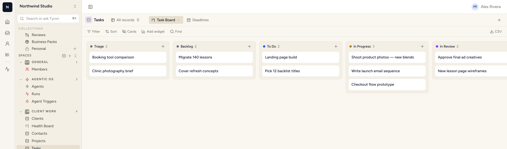
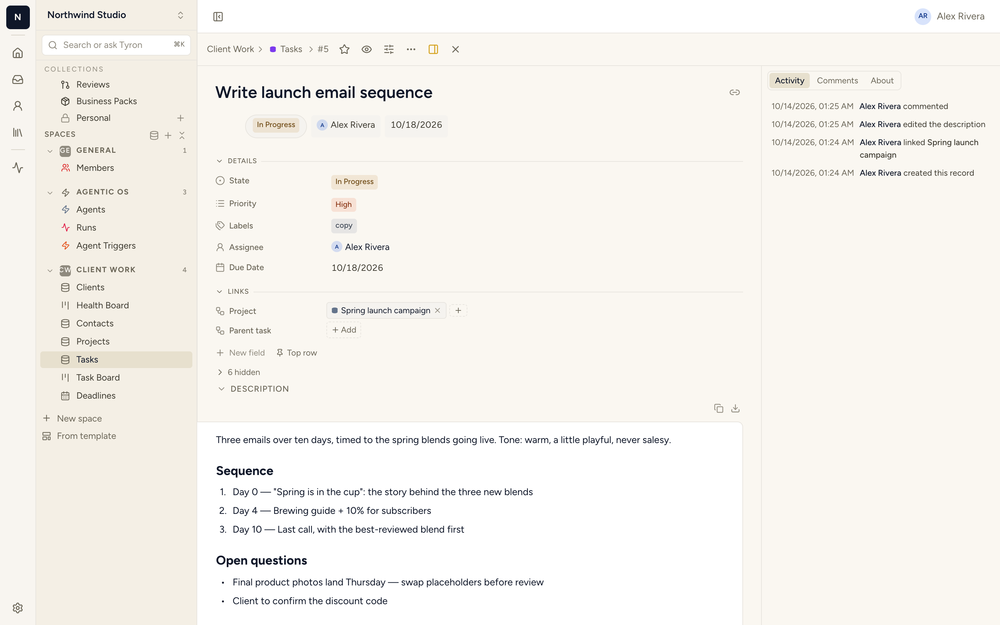
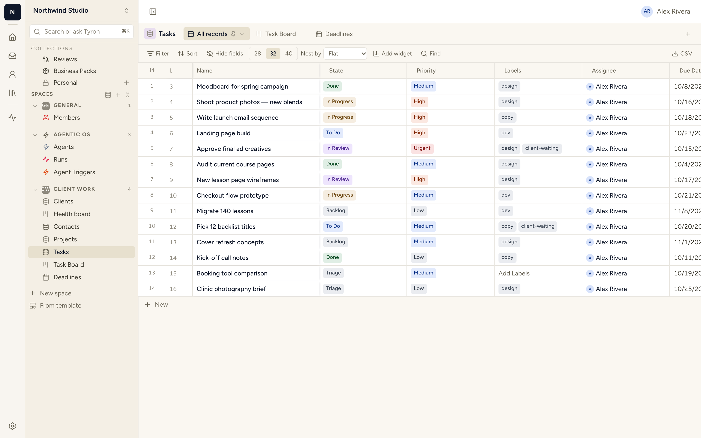
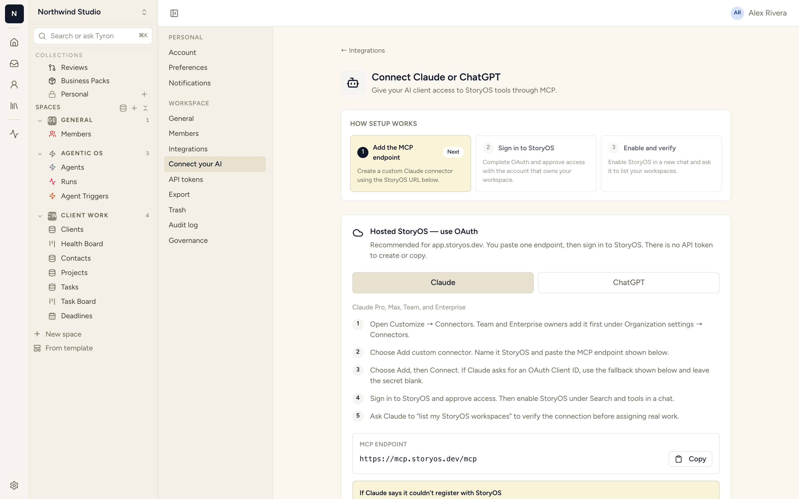
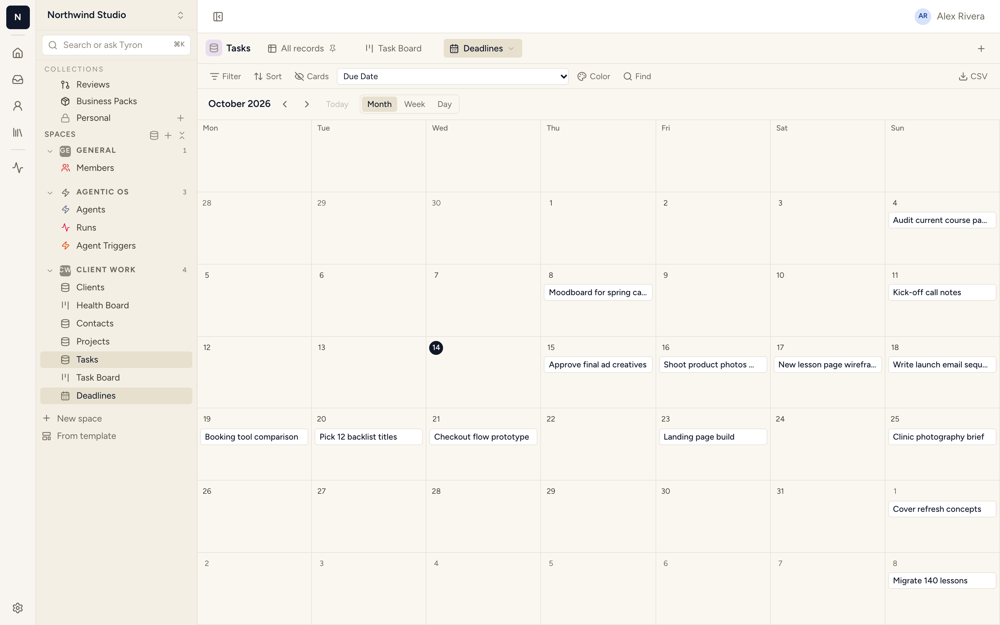

<p align="center">
  <picture>
    <source media="(prefers-color-scheme: dark)" srcset="apps/web/public/brand/logo-dark.svg" />
    
  </picture>
</p>

<p align="center">
  <strong>The open-source work OS your AI can actually run.</strong><br/>
  Relational databases for the whole company, with a public API and an MCP server, so your own AI works inside it, not beside it.
</p>

<p align="center">
  <a href="LICENSE"></a>
  <a href="https://docs.storyos.dev"></a>
  
  
</p>

---

StoryOS is a connected-database work OS. You define databases, link them with real two-sided relations, and work the same records through nine kinds of view. Clients, tasks, content pipelines, CRM and sprints all live in one engine, on your schema, on your server.

It is built **API-first and agent-first**. The web app is just one client of a public REST API. Everything it can do, a script can do, and so can the AI you already use, through the built-in MCP server. When an agent does something risky, it waits for a human to approve it first.

**Hosted:** [app.storyos.dev](https://app.storyos.dev) · **Docs:** [docs.storyos.dev](https://docs.storyos.dev) · **Self-host:** one `docker compose up` (below)



## What's in it

**The engine**
- **Databases and fields.** Text, rich text, number, checkbox, date, select, multi-select, workflow (a database's one canonical status), URL, email, colour, person, attachment, relation, lookup, rollup, formula, button and **AI fields** (a value computed by a model from the record's own fields). Schema changes are API calls, not migrations. → [Databases and fields](https://docs.storyos.dev/concepts/databases-and-fields/)
- **Relations, lookups and rollups.** Relations are paired on both sides, one-to-many or many-to-many, across spaces. Lookups show a related record's field; rollups aggregate related records. → [Relations](https://docs.storyos.dev/concepts/relations/)
- **Formulas** and **validation rules**. → [Formulas](https://docs.storyos.dev/concepts/formulas/)
- **Views:** table, board, calendar, gallery, list, feed, timeline, form and dashboard. Each view saves its own filters and sorts, and views can be published. → [Views](https://docs.storyos.dev/concepts/views/)
- **Every record is a page,** with fields, a rich-text body, attachments, comments with @mentions, a full activity trail and version history you can restore from. → [Record history](https://docs.storyos.dev/concepts/record-history/)





**AI and agents**
- **MCP server, built in.** Connect Claude or any MCP client to the hosted endpoint over OAuth, or run it yourself. Every API capability ships with its MCP tool or a written reason why not, and CI enforces it. → [MCP](https://docs.storyos.dev/mcp/overview/)
- **Tyron**, the in-app assistant: ask about your workspace, or have it change things for you. → [Tyron](https://docs.storyos.dev/concepts/tyron/)
- **Skills.** Reusable instructions your AI can run against your workspace, kept private, shared with members, or published. → [Skills](https://docs.storyos.dev/concepts/skills/)
- **Approval gates and agent runs.** Risky actions wait for a human, and every agent run is recorded. → [Approval gates](https://docs.storyos.dev/concepts/approval-gates/) · [Agent runs](https://docs.storyos.dev/concepts/agent-runs/)



**Working in it**
- **Templates and packs:** installable workspaces for client work, CRM, content, social, dev projects, people ops and more, with sample data.
- **Automations and buttons:** trigger on record changes or a schedule, or run an action with one click. → [Automations](https://docs.storyos.dev/concepts/automations/)
- **Access that holds:** workspace roles, guests scoped to a single space or record, and **client portals** for people outside your team. → [Access and roles](https://docs.storyos.dev/concepts/access-and-roles/) · [Client portals](https://docs.storyos.dev/guides/client-portals/)
- **Personal space, split screen, Cmd+K, Inbox and My Work.**



**Data in and out**
- **Import:** CSV with type inference and a dry run, and a **Linear importer** (each team becomes a space, with issues, projects, cycles and labels; re-running it updates rather than duplicates). → [Migrate your data](https://docs.storyos.dev/guides/migrate-data/) · [From Linear](https://docs.storyos.dev/guides/migrate-from-linear/)
- **Sources:** scheduled pulls from YouTube, Meta, X, Shopify and any Apify actor into a database. → [Sources](https://docs.storyos.dev/guides/sources/)
- **GitHub:** PRs link to records and can move their status as they open, get reviewed and merge. **Google Calendar** sync.
- **Webhooks** and **PDF export.** → [Webhooks](https://docs.storyos.dev/guides/webhooks/)

**API-first**
- A versioned REST API under `/api/v1`, an OpenAPI 3.1 spec generated from code, and interactive docs at `/api/docs` on every instance.
- Personal access tokens with read / write / admin scopes, OAuth for connected AI, rate limiting, and a query endpoint with a filter language. → [API guides](docs/api/)

## Install (self-hosted)

```bash
git clone https://github.com/StoryFunnels/storyOS.git storyos && cd storyos
echo "BETTER_AUTH_SECRET=$(openssl rand -hex 32)" > .env
docker compose up -d
```

That starts Postgres, the API, the web app and the MCP server behind a Caddy proxy. Open **http://localhost** and sign up: the first account creates its own workspace, and migrations run automatically when the API boots. 1 GB of RAM is plenty for a small team.

Email, Google sign-in, S3/MinIO attachments (`docker compose --profile minio up -d`), backups and upgrades are covered in **[docs/self-hosting.md](docs/self-hosting.md)** and **[docs.storyos.dev/self-hosting](https://docs.storyos.dev/self-hosting/overview/)**.

## Develop

Node ≥ 22 and pnpm 10.

```bash
pnpm install
docker compose -f docker-compose.dev.yml up -d   # Postgres :5432 + Mailpit :8025 (dev infra only)
cp apps/api/.env.example apps/api/.env
pnpm dev                                          # api :3001, web :3000
```

`apps/api/.env` is read in development only and never overrides a variable that is already set, so `DATABASE_URL=… pnpm dev` still wins. In production the containers read real environment variables, and no `.env` is required.

The full local CI, which is the same set of checks the PR gate runs:

```bash
pnpm lint && pnpm typecheck && pnpm test && pnpm build && pnpm docs:check && pnpm install --frozen-lockfile
```

If you change API surface, run `pnpm sdk:generate` and commit the result. CI fails on OpenAPI/SDK drift. **Before your first PR, read [CONTRIBUTING.md](CONTRIBUTING.md).**

## Principles

1. **Relations are the core primitive.** A database without relations is a spreadsheet.
2. **API-first, no exceptions.** The UI uses the same public API everyone else gets.
3. **Your AI is a first-class client.** If the API can do it, MCP can do it, or there's a written reason why not.
4. **A control that says "done" must do it.** Permissions and approval gates are verified against what the server enforces, not what the screen shows.
5. **Capability is never paywalled.** The self-hosted core is fully capable and free forever.
6. **Schema is data.** Databases, fields, relations and views are API resources with stable IDs.
7. **Boring, predictable, self-hostable.** It runs a 10-person agency on a $10 VPS.

## Repo map

| Path | What's there |
|---|---|
| [apps/api](apps/api/) | NestJS (Fastify) REST API, the product's brain |
| [apps/web](apps/web/) | Next.js web app, one client of the API |
| [apps/docs](apps/docs/) | The public docs site, [docs.storyos.dev](https://docs.storyos.dev) |
| [packages/mcp](packages/mcp/) | The MCP server: hosted at `mcp.storyos.dev`, or run your own ([setup](packages/mcp/README.md)) |
| [packages/schemas](packages/schemas/) | Shared zod schemas and the formula engine |
| [packages/sdk](packages/sdk/) | Typed client generated from the OpenAPI spec |
| [packages/config](packages/config/) | Shared TypeScript config |
| [docs/architecture/](docs/architecture/) | Meta-model, record storage, API conventions, auth, [parallel work](docs/architecture/parallel-work.md) |
| [docs/decisions/](docs/decisions/) | ADRs: the decisions we don't relitigate |
| [docs/api/](docs/api/) | API guides: auth, querying, building an MCP server |
| [docs/product/](docs/product/) | **Internal** planning and specs. Published product docs live in [apps/docs](apps/docs/). |
| [tickets/](tickets/) | The original `MN-###` build backlog, kept as history. Current work is tracked in StoryOS itself. |

## Stack

TypeScript monorepo (pnpm + Turborepo) · NestJS 11 on Fastify · Next.js 16 / React 19 · PostgreSQL 16 (the only datastore) · Drizzle ORM · better-auth · BlockNote · zod 4 · MCP TypeScript SDK · OpenAPI 3.1 generated from code. The rationale is in [ADR-0001](docs/decisions/ADR-0001-stack.md).

## License

**Dual-licensed.** [AGPL-3.0-or-later](LICENSE) for everyone, free forever; if you host it as a service, share your changes back. A separate **commercial license** is available for organisations that cannot accept the AGPL: same code, different legal terms. See [docs/licensing.md](docs/licensing.md).

Contributions require agreeing to the [Contributor License Agreement](CLA.md). See [CONTRIBUTING.md](CONTRIBUTING.md).
